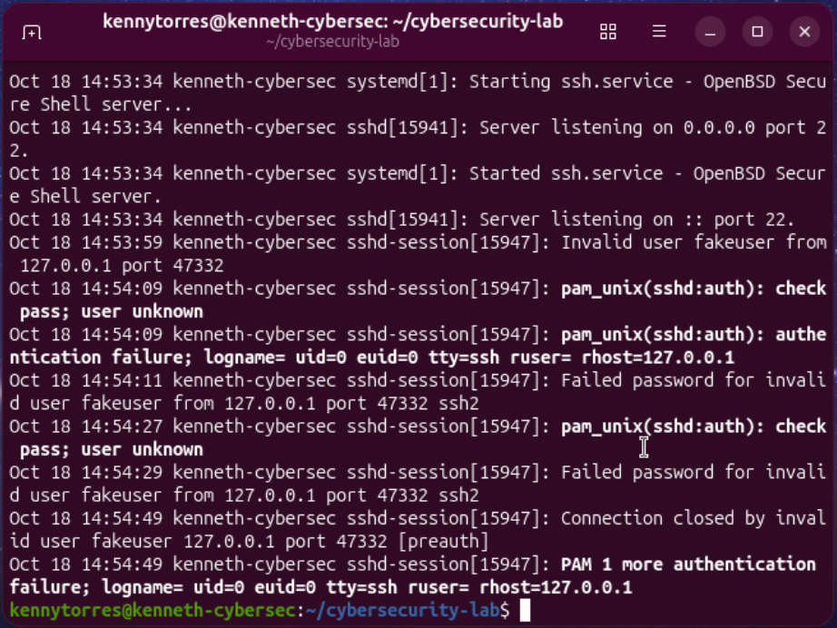
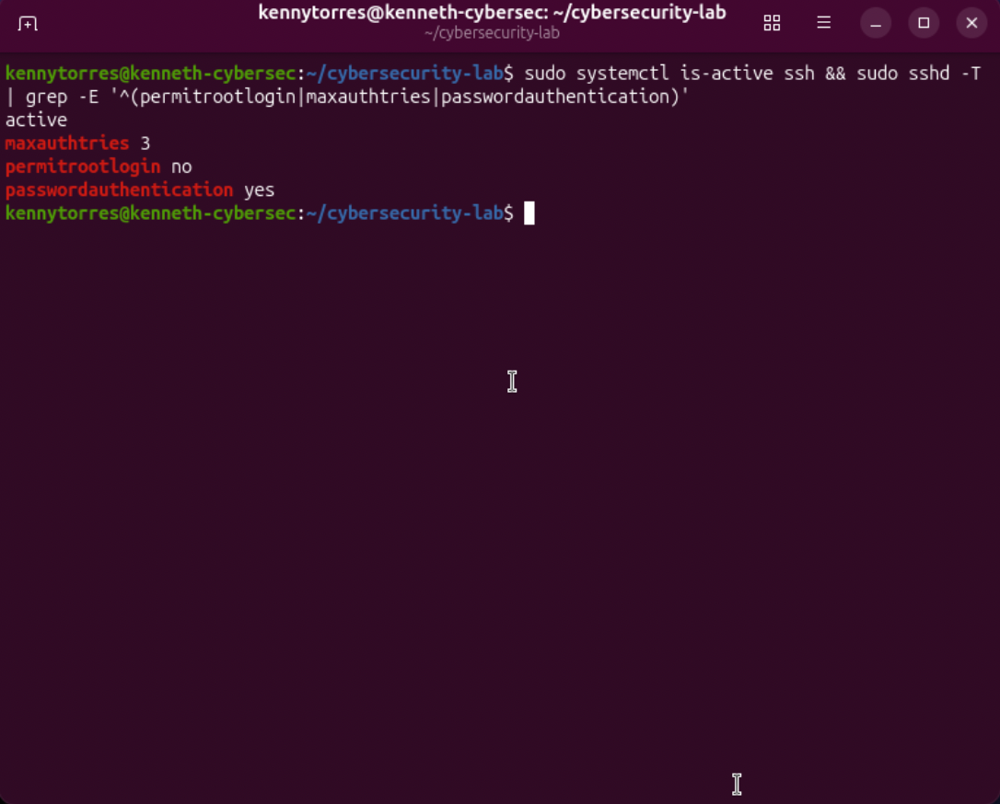
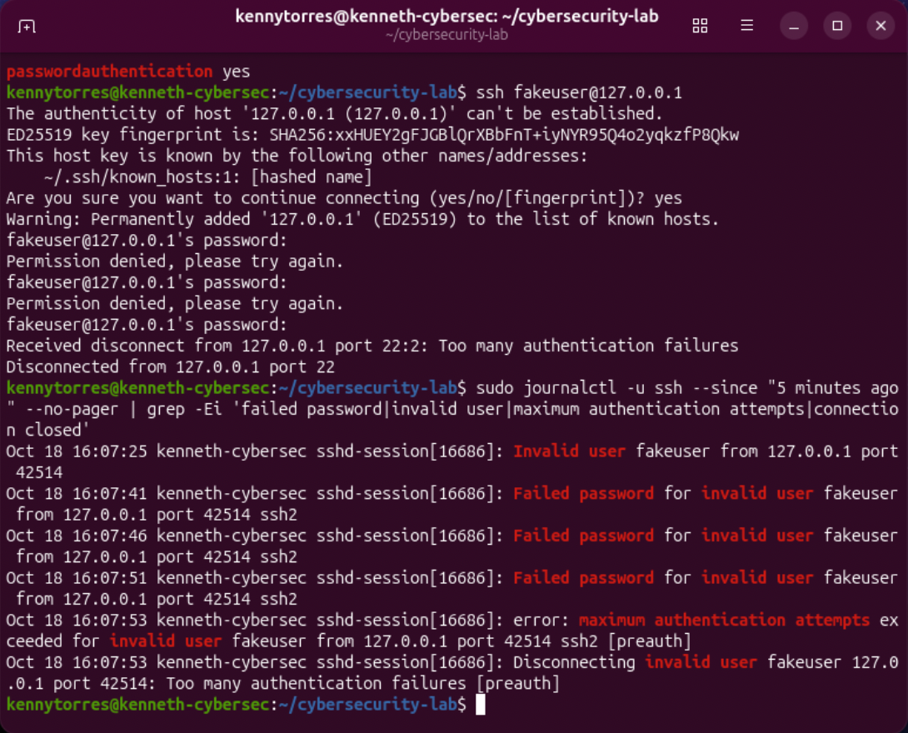

# Linux SSH Authentication Monitoring and Hardening Lab

A controlled Ubuntu VM lab demonstrating authentication log analysis, SSH configuration review, hardening, and validation.

## Objective

Analyze failed SSH logins, summarize them by source IP, apply safer SSH settings, and verify the server enforces the changes.

## Scope and environment

- Ubuntu virtual machine running OpenSSH and systemd journal logging
- Test source: `127.0.0.1` (the same VM)
- Controlled attempts against a deliberately invalid username on the author's own VM
- No external systems or real user accounts involved

## What I did

1. Reviewed SSH authentication events with `journalctl`.
2. Created a Bash analyzer that counts failed password events by source IP.
3. Reviewed effective SSH settings before changing them.
4. Set `PermitRootLogin no` and `MaxAuthTries 3` in a lab-specific SSH configuration file.
5. Validated the configuration with `sshd -t`, restarted SSH, and confirmed the service remained active.
6. Made three controlled failed login attempts. The server logged the failures, reported that the authentication attempt limit was exceeded, and disconnected the test client.

## SSH settings

| Setting | Before | After | Reason |
|---|---|---|---|
| `MaxAuthTries` | 6 | 3 | Reduce the attempts allowed per connection. |
| `PermitRootLogin` | `prohibit-password` | `no` | Disable SSH login for root, including key-based login. |
| `PasswordAuthentication` | `yes` | `yes` | Kept enabled because SSH key access was not configured. Disable it only after setting up and verifying key access. |

## Run the analyzer

After cloning or copying this project onto the Ubuntu VM, run it from the project directory:

```bash
bash scripts/analyze_auth_logs.sh
```

The default time window is the last hour. You can pass another `journalctl` time expression:

```bash
bash scripts/analyze_auth_logs.sh '5 minutes ago'
```

The script may prompt for the Ubuntu password so it can read the system journal.

## Evidence

### Failed SSH authentication



### Effective settings after hardening



### Authentication attempt limit validation



## Limitations and next step

All attempts came from loopback on one VM. This demonstrates the monitoring and control validation workflow, not detection of a real external attack. The analyzer counts `Failed password` records by IPv4 source and does not alert or correlate activity across hosts. Password authentication remains enabled; a next step is to configure and verify SSH key access, disable password authentication, and repeat the validation.
